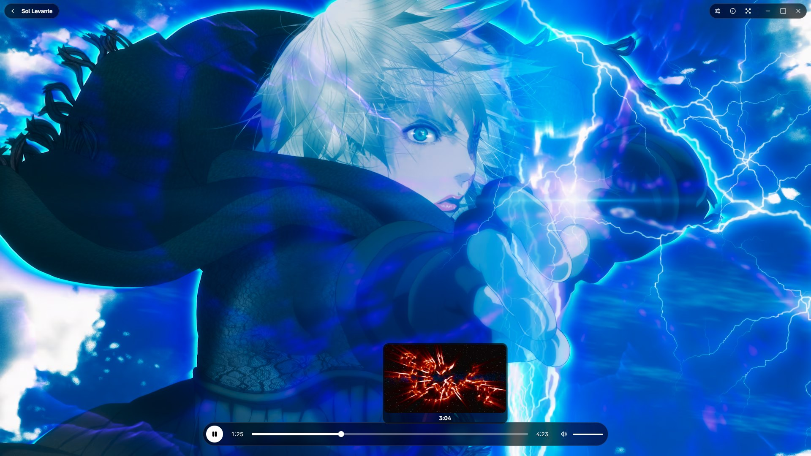
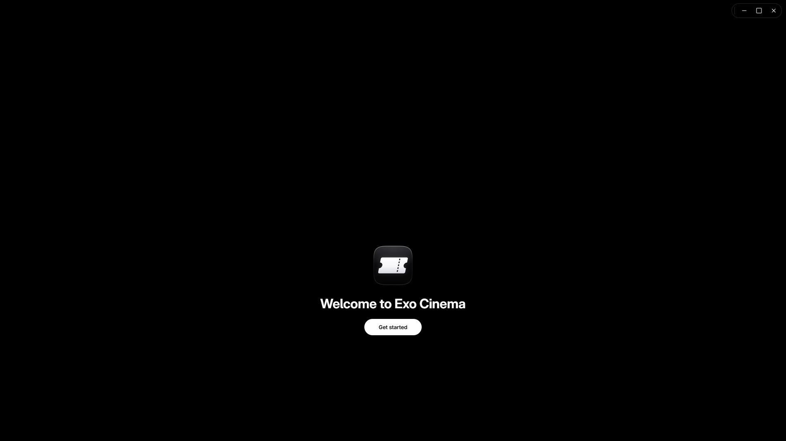
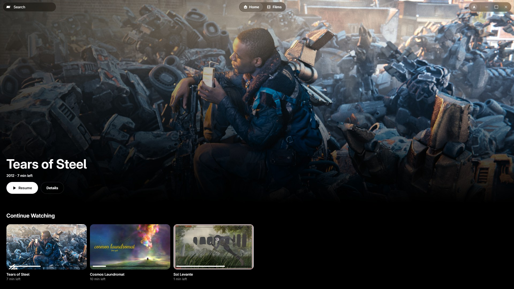
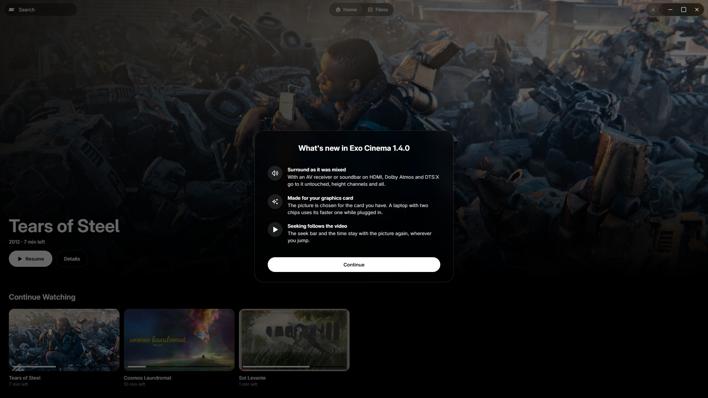

<p align="center"></p>
<h1 align="center">Exo Cinema</h1>
<p align="center"><strong>The films and shows on your Jellyfin server in Exo's look for Windows 11, with a native player that keeps up with anything.</strong></p>

<p align="center">
  <a href="https://getexo.app/download/"><strong>Download for Windows 11</strong></a>
  · <a href="https://getexo.app/cinema/changelog">What's new</a>
  · <a href="CHANGELOG.md">Changelog</a>
  · <a href="PRIVACY.md">Privacy</a>
  · <a href="SECURITY.md">Security</a>
  · <a href="LICENSE">License</a>
</p>



## Download

Windows installers will be published in [Exo Cinema Releases](https://github.com/UhhErix/Exo-Cinema/releases). See [RELEASES.md](RELEASES.md) for the installer version and checksum. Until the GitHub assets are published, use the current download below.

| File | Version | SHA-256 |
| --- | --- | --- |
| [ExoCinema-Setup.exe](https://getexo.app/download/) | the newest, on [getexo.app/download](https://getexo.app/download/) | in [updates.getexo.app/v1/cinema/latest](https://updates.getexo.app/v1/cinema/latest), under `checks.setup.sha256` |

**Requirements:** Windows 11 x64 with WebView2 (built into Windows 11; Setup installs it if it's missing). Installs for your Windows user only, in `%LOCALAPPDATA%\ExoCinema\app`, with no administrator rights.

**Check your download.** The installer isn't code-signed yet, so Windows SmartScreen may warn the first time (choose **More info**, then **Run anyway**). Before you run it, check that its hash matches the one the table points to:

```powershell
Get-FileHash .\ExoCinema-Setup.exe -Algorithm SHA256
```

## Install

1. Download **ExoCinema-Setup.exe** (above) and check its hash.
2. Run it, choose **Install**, then **Open Exo Cinema**. The first run signs you in to your Exo account, then to your Jellyfin server; Home fills from the server as soon as you connect.
3. When a new version is out, Exo Cinema offers it as it opens: **Update now** downloads it, checks it and installs it over the one you have, and your sign-ins and settings stay. It never interrupts while it's open.



## What's built in



- **Your Jellyfin server, in one sign-in:** connect with its address, username and password and it's your library: Home, Movies, Shows, search, the Watchlist, History and every title. Where you left off, what's played and your favorites live on the server, so other Jellyfin apps that report to it stay in step. It plays the original file, never a conversion. Exo Cinema plays from a Jellyfin server and nothing else: until you connect, every room is the sign-in.
- **Everything you watch, in its rows:** Continue watching, Next up, Airing soon and your Watchlist on Home; History by day; Movies and Shows as grids that grow as you scroll; Ctrl+K searches the server as you type.
- **Kept from before 1.5:** if you used Exo Cinema when it played from other sources, the Watchlist and History it kept are still there, each title by its name; press one to find it on your server.
- **One Exo account:** the same email and password as Exo Launcher and Exo Browser. It carries your choices to your other PCs.
- **A native player:** mpv draws the picture with hardware decoding, HDR and Dolby Vision tone mapping and high-quality scaling, at the video's own frame rate.
- **HDR for films, automatic:** a film or show with an HDR picture switches its screen to HDR while it plays and back after, with no setting, and stays on through a change to the next HDR episode that starts within ten seconds. _Checked in code only._
- **Liquid Glass over the picture:** the controls blur the video under them as it plays, drawn by the player on the graphics card at no cost to playback.
- **Pictures on the seek bar:** hover it to see the moment you'd jump to, drawn on the spot, and drag it as fast as you like.
- **The best version and tracks for you:** when the server has more than one version of a title, Play picks the best for your PC and connection (the chevron beside it lists them all), and the best recording in the language you'd expect, with full subtitles in yours when you need them.
- **The things you reach for:** audio and subtitle tracks remembered for each show, playback speed, Skip intro and Skip credits, and Up Next that plays the next episode on its own.
- **Steady over a slow link:** the player reads far ahead, waits for a few seconds of picture rather than stuttering, asks again when a host drops the film or goes quiet, and never holds the window while it waits.
- **Media keys and Windows' media controls:** play, pause and next from the keyboard with another window in front, and what's playing, with its poster, in Windows' media controls and Exo Launcher's Now Playing.
- **Light on your PC:** close to no CPU while idle or behind a game, and the picture's quality picked for your PC as it plays.
- **Exo Launcher's look:** Void black, Liquid Glass or solid, Geist and Exo's icons, and an opening that has Home ready when it lifts.

## The player

- **Built on mpv.** libmpv decodes and draws into the window itself, under the interface, so the picture never passes through a web page: hardware decoding through Direct3D 11, mpv's high-quality scalers picked for your PC as it plays (lighter on integrated graphics, on battery, or when frames drop), and HDR and Dolby Vision tone mapped for your screen.
- **Anime redrawn by ArtCNN.** A neural network trained on drawn art redraws anime at up to 4K and shrinks it back to your screen: crisp lines, backgrounds with their texture. It was chosen on a picture bench against Anime4K and NVIDIA's upscaler, and it is built for your graphics card once, in the background.
- **AI upscaling on RTX cards.** A film or show smaller than your screen is enlarged by NVIDIA's RTX Video Super Resolution when it's switched on (Exo Launcher's PC > Display). Both upscalers step aside while a game runs. On a laptop with two graphics chips, the player draws on the faster one while it's plugged in.
- **Surround as it was mixed.** With an AV receiver or soundbar on HDMI, Dolby Atmos, DTS:X and the rest go to it untouched, so it plays their height channels, and its own volume sets the level. It steps aside while another app plays through it, a game runs or an Exo voice call is on.
- **Pictures on the seek bar.** Hover it for the moment you'd jump to, drawn on the spot by a second player kept out of sight.
- **Glass that moves with the picture.** The glass under the controls is drawn by the player as part of each frame, so it never lags the video and never copies frames off the graphics card. With the controls up over 4K60 Dolby Vision, the test PC dropped no frames.
- **Audio, subtitles and speed** live in one menu under the sliders button at the top right. A video starts on its best recording in the language you'd expect (Japanese for anime) with full subtitles in yours when the audio isn't; pick a language once and the show's next episodes start with it. Plain subtitles are drawn in Inter and rise above the controls while they show.
- **Skip intro and Up Next.** Openings and credits named in the file's chapters get a Skip button; near the end of an episode the next one counts down, and **Not now** stops it.
- **Keys you know:** Space or K to pause, arrows to seek and set the volume, J and L for ten seconds, F for full screen, M to mute, I for what's playing and how.

## Settings

- **Account:** your Exo account: sign in or create one; signed in, Sync now, Change password, New recovery code, Signed-in PCs, Export my data, Sign out and Delete account.
- **Playback:** whether the next episode plays by itself. The picture's quality and hardware decoding need no setting: Exo Cinema picks them for your PC.
- **Jellyfin:** who's connected, and **Sign out**; signed out, your server's address, username and password, and **Connect**, which says whether it really worked.
- **Storage:** the pictures kept on this PC, and **Clear**.
- **About:** your version, the changelog, Check for updates, and Report a problem, Privacy and Licenses.



## How it works

Exo Cinema is a native Windows app built like Exo Launcher: WinUI 3 on .NET, with its interface in one Microsoft Edge WebView2 page that floats over the video. The picture comes from libmpv, which draws straight into the window.

- **Its own interface:** Exo Cinema's page, served from the app folder, not the web. Everything it shows, pictures included, comes through the app.
- **Your server, directly:** Exo Cinema asks your Jellyfin server itself and plays the file from it, or from where the server says the file is kept. There is no Exo server in between.

## Privacy and safety

- **No ads and no usage tracking.** What you watch is between this PC and your Jellyfin server; none of it goes to Exo. Crash, freeze and error reports are sent by default, stripped of addresses, titles, file names and names ([what each holds](PRIVACY.md)). Your Exo account syncs your choices and, on a PC that used Exo Cinema before 1.5, what it kept then.
- **What leaves your PC** is what watching needs: requests to your Jellyfin server (for what you open and play) and to where it keeps a file, the Exo account, reports when something breaks, and the update check as Exo Cinema opens (Exo's update address, `updates.getexo.app`, and nothing else). The [privacy policy](PRIVACY.md) lists every destination and what is sent.
- **Your Jellyfin sign-in stays on this PC.** The password is never kept; the server's token is sealed with Windows' data protection, doesn't sync through your Exo account and, like the server's address, is never written to the log.
- **Nothing but your server.** Exo Cinema asks no public catalog and no picture or lookup service: every film, show and picture comes from the server you signed in to.
- **Found a security problem?** Report it privately at [getexo.app/help](https://getexo.app/help), not in public. See [SECURITY.md](SECURITY.md).

Film images in these pictures: Sol Levante © Akira Saitoh, Production I.G, Netflix (CC BY 4.0); Tears of Steel, Sintel, Big Buck Bunny, Cosmos Laundromat (CC BY 3.0), Spring, Elephants Dream (CC BY 4.0) © Blender Foundation. They come from a test server, not anyone's library.

## Contributing

Bug reports, ideas and pull requests are welcome. See [CONTRIBUTING.md](CONTRIBUTING.md).

## Build and test

Use a Windows x64 development machine with the .NET SDK pinned in [global.json](global.json), the Windows 11 SDK, and the .NET desktop development workload. From the repository root:

```powershell
dotnet build src/ExoCinema/ExoCinema.csproj -c Release -p:Platform=x64
dotnet test --project tests/ExoCinema.Tests -c Release -p:Platform=x64
```

## License

Exo Cinema's first-party source is available under the [MIT license](LICENSE).

**Open-source parts that ship with Exo Cinema** keep their own licenses, and their source is public:

- [libmpv](https://github.com/mpv-player/mpv) (LGPL), the player, with [FFmpeg](https://github.com/FFmpeg/FFmpeg) (LGPL) inside it. It ships as its own file you may replace with your own build.
- [ArtCNN](https://github.com/Artoriuz/ArtCNN) (MIT), the anime upscaler's network, as mpv shaders.

Every bundled library, font and tool is listed in [Third-party notices](THIRD_PARTY_NOTICES.md).

**Not affiliated.** Exo Cinema is independent and not affiliated with or endorsed by the Jellyfin project, the mpv or FFmpeg projects, Microsoft, or any service it works with. Their names and logos belong to their owners. The video in the pictures above is Jellyfin's test footage ([CC BY-SA 4.0](https://creativecommons.org/licenses/by-sa/4.0/)), and the server and user in them are made up.

## Also from Exo

- **[Exo Launcher](https://getexo.app/launcher)** — every game store, Discord, music, captures and mouse in one app
- **[Exo Browser](https://getexo.app/browser)** — private browser with Exo Shield and Exo Vault built in

---

[Help](docs/HELP.md) · [Ask or report a problem](https://getexo.app/help) · [Support development](https://www.buymeacoffee.com/UhhErix)

© 2026 Erix.
